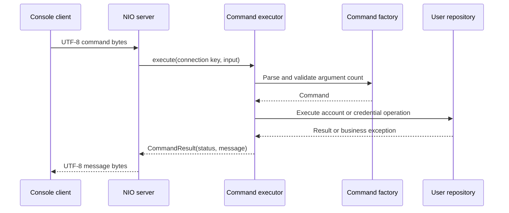

# Architecture and contributor guide

Password Vault runs as two Java processes: a console client and a server bound to `localhost:7777`. Both use NIO channels, but the client blocks while waiting for each response. The server selects readable connections on one thread and executes commands synchronously on that same thread.

For setup, build commands, and interactive usage, see the [README](../README.md). For limitations in this design, see [current problems](CURRENT_PROBLEMS.md).

## Request flow

The repository call is skipped for `help` and unrecognized commands. `disconnect` is handled entirely by the client. This diagram describes logical steps; the transport has no framing that guarantees a whole command arrives in one read.

| Component | Responsibility | Source |
| --- | --- | --- |
| Client | Reads console input, handles disconnect, sends commands, prints responses. | [PasswordVaultClient](../src/main/java/client/PasswordVaultClient.java) |
| Server | Accepts connections and passes received bytes to the executor. | [PasswordVaultServer](../src/main/java/server/PasswordVaultServer.java) |
| Factory | Parses case-sensitive names and quoted arguments, validates command argument counts. | [CommandFactoryImpl](../src/main/java/server/command/factory/CommandFactoryImpl.java) |
| Commands | Capture arguments and invoke one repository operation, or return help text. | [Command implementations](../src/main/java/server/command/commands) |
| Executor | Logs exceptions and converts them to error results. | [CommandExecutor](../src/main/java/server/command/CommandExecutor.java) |
| Repository | Owns account rules, session state, and website credential operations. | [AbstractUserRepository](../src/main/java/server/repository/AbstractUserRepository.java) |
| Adapter | Loads and saves the complete account map as a serialized object. | [FileUserAdapter](../src/main/java/server/adapter/FileUserAdapter.java) |

## Accounts, sessions, and credentials

`User` contains a vault username, an account password hash, and a mutable map from website strings to `WebsitePair` values. A pair contains the website username and encrypted password bytes. Equality between users depends only on the vault username.

Registration saves a new account without logging it in. Login creates a `Session` indexed by the connection's `SelectionKey`; separate connections can authenticate the same account. Logout removes that session without closing the connection. Sessions are never serialized. The current disconnect path closes the channel but does not remove the corresponding repository session.

Website commands use the authenticated session to select the vault. They do not select a vault by the website username argument. Each website key holds one pair, so a second entry for the same website is rejected even if its username differs. Retrieval and removal require the supplied website username to match the stored value exactly. Retrieval returns `username password` as plain response text.

## Password services

| Service | Current behavior |
| --- | --- |
| Account hashing | SHA-256 of UTF-8 input, encoded as lowercase hexadecimal; no salt or work factor. |
| Website encryption | UTF-8 plaintext encrypted through JCA `AES`, with provider-selected mode and padding and one shared key file. |
| Password generation | `SecureRandom` selects each character independently from letters, digits, and punctuation; default length 16, minimum supported length 12. No character-category guarantee. |
| Exposure checking | Blocking Enzoic request using a ten-character SHA-256 prefix. A matching full hash with `revealedInExposure=true` is rejected; HTTP 404 is accepted. |

Both added and generated website passwords go through the exposure checker. Account registration does not. A rejected generated password is not retried. HTTP failures are wrapped in runtime exceptions and become a generic error through the executor.

## Files and persistence

All default paths are relative to the server process working directory. Runtime files are separate from the executable JAR.

| File | Contents and lifecycle |
| --- | --- |
| `ApiKey`, `ApiSecret` | Required by the default API checker at construction. Read as complete strings without trimming. |
| `SecretKey` | Raw AES key bytes. Loaded if present; otherwise a 128-bit key is generated, printed, written, and given POSIX permissions. |
| `users` | One serialized map containing all account hashes and encrypted website passwords. An absent file produces an empty map. |
| `error.log` | Appended timestamps, exception messages, and stack traces. Created when logging first writes to it. |

Successful registration, addition, and removal call `saveChanges()`. Generation delegates to addition and then saves again. `AdapterUserRepository.close()` saves and closes the HTTP checker. `PasswordVaultServer.stop()` invokes that closure; the command-line server has no shutdown hook to invoke `stop()` automatically.

Saving truncates and rewrites `users` directly, without an atomic replacement, transaction, or backup. The matching `SecretKey` is needed to recover stored website passwords. Losing it cannot be repaired by generating a new key. Persistence changes must preserve both record compatibility and the relationship between stored ciphertext and key material.

## Command contracts and errors

Commands implement `Command`; repository-dependent commands extend `AbstractCommand`. Constructors check argument counts with `Command.validateArgs()` before accessing tokens. Repository operations validate session state and business rules during execution.

The parser splits only on literal spaces outside double quotes, strips every double quote, and retains empty tokens. It does not normalize whitespace, process escapes, or reject unmatched quotes. For example, `help extra` produces `Arguments count mismatch`, and `Help` produces `Not recognised command`.

`PasswordVaultException` and its subclasses represent business errors. The executor logs them and returns their messages with `Status.ERROR`. Other exceptions are logged and become `Internal server error`. The server sends only `CommandResult.message()`, so clients cannot read the status as a separate protocol field. Help text can contain multiple lines.

## Adding a command

1. Add a class in `server.command.commands` implementing `Command`, or extending `AbstractCommand` if it needs a repository and connection key.
2. Define its `COMMAND_STRING` and expected argument count. Validate arguments before indexing them.
3. Implement `execute()` with an appropriate `CommandResult`. Keep account and credential rules in the repository.
4. Add dispatch to `CommandFactoryImpl` and update `HelpCommand` and the README command table.
5. Document argument meanings, return values, session requirements, and exceptions in JavaDoc.
6. Add focused factory or command tests. Mock dependencies so tests do not use live API credentials or real vault data.

## Validation and documentation

Run `./mvnw clean verify` on Linux/macOS or `.\mvnw.cmd clean verify` on Windows. The build compiles with JDK 25, runs the JUnit suite with Mockito, and packages an executable JAR including runtime dependencies. Test reports are under `target/surefire-reports/`. The existing tests cover individual components; they do not establish correctness of the complete network transport.

The [README](../README.md#generate-api-documentation) includes the JavaDoc generation command. Public interfaces carry the shared method contracts; implementations inherit those descriptions unless they need to explain different details. Keep documentation aligned with actual behavior, and update the problems guide when a limitation is fixed or newly verified.
